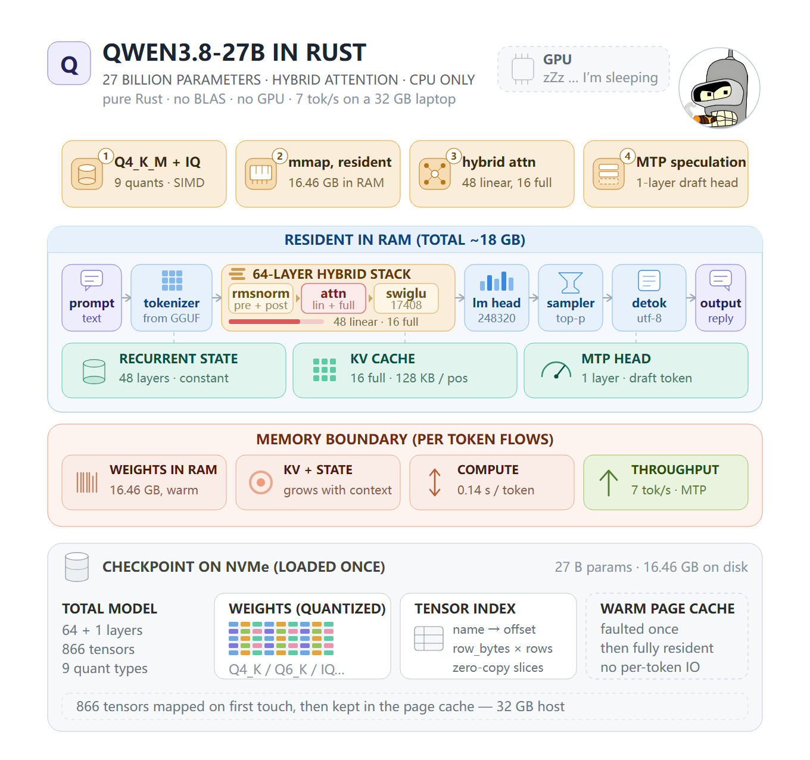

# qwen3.8_27b_in_rust
**Runs the Qwen3.8 27B LLM on a single CPU with >=8GB of RAM, delivering up to ~7 tok/s. Written in pure Rust.**

No GPU, no BLAS, no ML framework: the quantized GEMM/GEMV kernels, the hybrid linear/full attention,
the MTP speculative decoder and the sampler are all hand-written, and the whole model is a single
16.5 GB GGUF file mapped straight off the disk.  

# Requirements
| | |
| --- | --- |
| OS  | Linux/x86-64, Windows/x86-64, MacOS/arm64 is coming soon! |
| CPU | AVX2 + FMA on x86-64 is better, NEON on arm64 is coming soon! |
| GPU | NO |
| RAM | >=8GB |
| Storage | ~20GB free |

# Usage
```
qwen38_27b_in_rust --model MODEL.gguf [--prompt TEXT] [options]
  --prompt TEXT       run one request
  --system TEXT       system instruction
  --max-tokens N      maximum generated tokens (default: 1024)
  --context N         context capacity (default: 4096)
  --temperature N     0 for greedy; default: 1.0
  --top-k N           sample from the best N tokens (default: 20)
  --top-p N           nucleus probability (default: 0.95)
  --presence-penalty N
  --no-thinking       answer directly instead of showing reasoning
  --reasoning-effort N  low, medium, or xhigh (default: xhigh)
  --threads N         worker threads for the kernels (default: one per core,
                      also honoured through RAYON_NUM_THREADS)
  --seed N            sampling seed
  --mtp-draft N       greedy speculative decoding with N drafts (0 = off)
```
example:  
```
> ./qwen38_27b_in_rust --model Qwen3.8-27B-UD-Q4_K_M.gguf --prompt Hello --max-tokens 256 --context 256 --no-thinking
Hello! How can I help you today?
```
speculative decoding(speedup ~1.8×):  
```
./qwen38_27b_in_rust --model Qwen3.8-27B-UD-Q4_K_M.gguf --prompt Hello \
  --max-tokens 256 --context 1024 --temperature 0 --mtp-draft 3
```

# Build
Fetch the source:

```
git clone https://github.com/StepfenShawn/qwen3.8_27b_in_rust.git
cd qwen3.8_27b_in_rust
```

```
cargo build --release
```

By default the crate is built for the x86-64 baseline (SSE2) and the AVX2 kernels are reached
through `#[target_feature]` plus a runtime feature check, so one binary runs on any AVX2 CPU:

```
# Linux / macOS / Git Bash
RUSTFLAGS="-C target-cpu=native" cargo build --release

# PowerShell
$env:RUSTFLAGS="-C target-cpu=native"; cargo build --release
```

What it changes, and what it does not:

* The quantized GEMM / GEMV kernels are hand-written AVX2+FMA intrinsics and are already
  compiled with those features on every build — `target-cpu` does not make them faster.
* The scalar stages around them (`q8_k` quantization, RMS norm, SwiGLU, the delta-rule
  recurrence, sampling) move from the SSE2 baseline to the host feature set, which
  additionally enables `vcvtph2ps` for the f16 block scales.
* Treat this as an opt-in for the
  scalar stages, not as a headline speedup. Decode is DRAM-bandwidth bound and cannot benefit.

NOTE: the resulting binary is tied to the CPU it was built on (or a newer one) and may crash
with `SIGILL` elsewhere. 

# What limits the speed: memory bandwidth

**Decoding in this project is bound by DRAM bandwidth, not by compute.** To emit one token the
program has to read every weight in the model once — 16.46 GB for Q4_K_M — and 16.46 GB fits in
no CPU cache, so nothing is reused. Throughput therefore reduces to a single line:
```
tokens/second = effective DRAM bandwidth ÷ bytes read per token
              = 34.5 GB/s ÷ 16.46 GB
              = 2.09 tok/s
```

That 34.5 GB/s is already ~86% of what a DDR4-3200 dual-channel board physically delivers
(~40 GB/s; the 51.2 GB/s on the memory spec sheet is a theoretical peak that no CPU workload
reaches). The distance to a faster machine is therefore a *bandwidth* distance, not a code
distance — see [Benchmarks](#benchmarks).

# Benchmarks
Windows, `Qwen3.8-27B-UD-Q4_K_M.gguf` (Q4_K_M, 16.5 GB):  

**Intel i7-14650HX (8 performance + 8 efficiency cores, 24 threads), 32 GB DDR5-5600 dual channel**

| run | prompt | output | TTFT | TPOT | decode |
| --- | --- | --- | --- | --- | --- |
| `--threads 24` | 57 | 106 | 5.32 s | 0.239 s | **4.17 tok/s** |
| `--threads 24 --temperature 0 --mtp-draft 3` | 57 | 99 | 4.06 s | 0.135 s | **7.39 tok/s** |

**Intel i7-11700 (8 cores / 16 threads), 32 GB DDR4-3200 dual channel**

| run | prompt | output | TTFT | TPOT | decode |
| --- | --- | --- | --- | --- | --- |
| `--threads 16` | 57 | 112 | 9.57 s | 0.523 s | **1.91 tok/s** |
| `--threads 16 --temperature 0 --mtp-draft 3` | 57 | 99 | 7.31 s | 0.339 s | **2.98 tok/s** |

**Intel i5-11260H (6 cores / 12 threads), 16 GB DDR4-3200 dual channel — 16.5 GB checkpoint does not fit!**

| run | prompt | output | TTFT | TPOT | decode |
| --- | --- | --- | --- | --- | --- |
| `--threads 12` | 57 | 103 | 13.2 s | 14.28 s | **0.07 tok/s** |
| `--threads 12 --temperature 0 --mtp-draft 3` | 57 | 99 | 12.7 s | 7.14 s | **0.14 tok/s** |

WHY SO SLOW!!! Because 15.7 GB of usable RAM cannot hold a 16.5 GB checkpoint, so the page cache evicts weights and every
token re-reads the file from NVMe: 16.46 GB / 16.26 s ≈ **1.0 GB/s**, i.e. disk-bound. Same code,
same quantization, **~120× slower than the DDR5 laptop** — throughput follows wherever the weights
have to come from, CPU speed barely matters. 32 GB is the practical floor for Q4_K_M; on 16 GB use
[IQ1_M](#fetch-the-checkpoint) (6.7 GB) instead.

# Fetch the checkpoint
* [Qwen3.8-27B-UD-Q4_K_M](https://www.modelscope.cn/models/unsloth/Qwen3.8-27B-GGUF/resolve/ba7608d4e5e1f3ea3d016cebd1c972c42686e9da/Qwen3.8-27B-UD-Q4_K_M.gguf)
* [Qwen3.8-27B-UD-IQ2_M](https://www.modelscope.cn/models/unsloth/Qwen3.8-27B-GGUF/resolve/1939530128ebc56fdd0213d25583cb85147c1cd5/Qwen3.8-27B-UD-IQ2_M.gguf)
* [Qwen3.8-27B-UD-IQ1_M](https://www.modelscope.cn/models/unsloth/Qwen3.8-27B-GGUF/resolve/1fa4a98544ac96043a10649853051f1d5e72a008/Qwen3.8-27B-UD-IQ1_M.gguf)